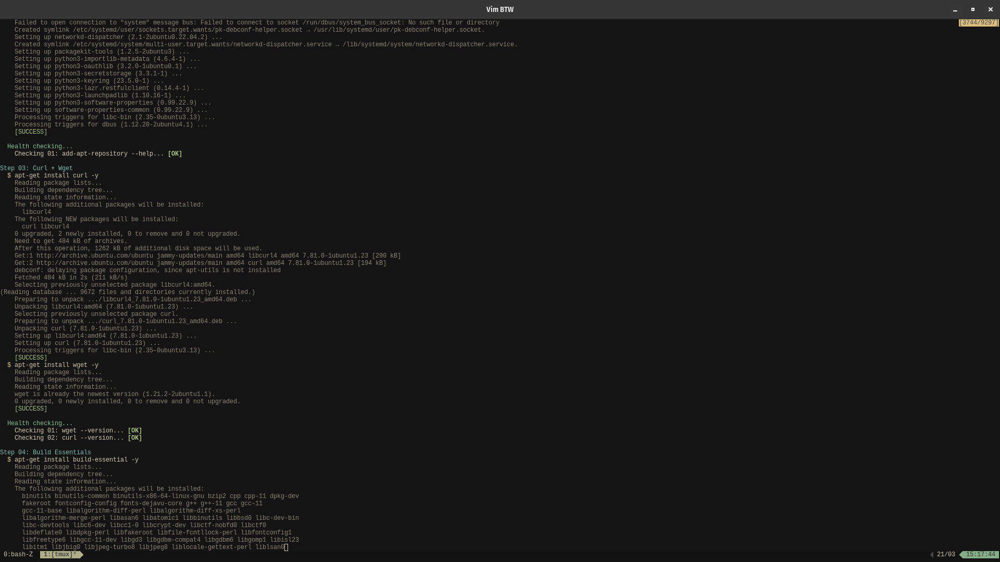

# Config manager



> [!WARNING]
> These are **my** personal configurations. Maybe it will not work on your environment.

If you want to see every single command that this tool will run on your machine
during the installation process, you can view [this file](./config-manager.sh),
or run `./config-manager.sh list` to print the pipeline with its groups and dependencies.

Access https://marcos-venicius.github.io/config-manager/ to see more details about the tool.

## Installing the tool

```bash
git clone https://github.com/marcos-venicius/config-manager.git ~/.config-manager
cd ~/.config-manager
```

That's it: no language runtime, no build step. `config-manager.sh` is a single bash script and
`configs/` holds the dotfiles it links.

## Commands

```bash
sudo ./config-manager.sh install      # run the pipeline
sudo ./config-manager.sh update       # pull and rebuild what was built from source
sudo ./config-manager.sh uninstall    # remove what this tool created
./config-manager.sh list              # print the pipeline, touching nothing
```

`update` only touches the tools built from a git clone (helix, tmuxer, mark): it pulls, rebuilds and
health checks them. A step that is not installed yet is skipped — that is `install`'s job.

`uninstall` removes **only what this tool created**: the `/usr/local/bin` symlinks, the
`update-alternatives` entries, the desktop entries and icons it wrote, the dotfile symlinks, and
`cargo uninstall alacritty`. It runs the pipeline backwards and is best effort, so a command with
nothing left to remove does not stop it.

It deliberately does **not** touch apt packages, toolchains (`~/.cargo`, `~/.nimble`, `/opt/go`,
`~/.dotnet`, `~/.asdf`) or the clones in `~/tools`. A dotfile is only unlinked when it still points at this
repository, so a link you repointed somewhere else survives. The `<name>.bak.<timestamp>` copies
made during install are left where they are — restoring the right one is your call.

## Ignoring steps

Every step belongs to one or more groups. Use `-ignore` to skip them:

```bash
sudo ./config-manager.sh install -ignore desktop,dotnet
```

Run `./config-manager.sh help` to list the groups.

Dependencies **are** resolved: a step can declare the groups it needs, and ignoring one of those
also skips everything that depends on it, transitively. Ignoring `cargo` therefore skips `helix`,
`alacritty` and `mark` as well, and the output says why:

```
Step 20/43 (ignored: helix needs cargo): Download & Build Helix
```

## Running a single group

`-only` is the inverse: it runs the groups you name and skips everything else.

```bash
sudo ./config-manager.sh install   -only claude
sudo ./config-manager.sh update    -only tmuxer
sudo ./config-manager.sh uninstall -only mark
```

`install` pulls in whatever the named groups are built on, transitively, so you do not have to
know the graph. `base` always comes along, since every group assumes apt, curl and build-essential.
It tells you what it added:

```
$ sudo ./config-manager.sh install -only tpm
-only tpm also runs what it needs: base, git, config-manager, tmux, fzf, jq, configs
```

Anything already in place is skipped by its health checks, so the extra groups usually cost seconds.

`update` and `uninstall` do **not** expand: they run exactly the groups you name. Uninstalling
`tpm` should not drag your dotfile symlinks out with it.

`-only` cannot be combined with `-ignore`.

## Desktop (GNOME)

The `desktop` group applies my GNOME preferences:

- Alt+Tab / Super+Tab only show what is in the current workspace
- Workspaces span every monitor (not only the primary one)
- The dock only shows apps from the current workspace
- Alt+Tab switches windows, Super+Tab switches applications
- Alacritty as the default terminal
- A wallpaper for each color scheme, which GNOME switches by itself: [white-wallpaper.jpg](./configs/wallpapers/white-wallpaper.jpg) in light mode, [manuej-Vor.jpg](./configs/wallpapers/manuej-Vor.jpg) in dark mode. `manuej-Vor.jpg` comes from the Ubuntu `ubuntu-wallpapers` package, under [CC BY-SA 4.0](https://creativecommons.org/licenses/by-sa/4.0/), not this repository's license

## Configs

The files inside [configs](./configs) are **symlinked** into your home (`~/.bashrc`, `~/.gitconfig`, `~/.tmux.conf`,
`~/.config/alacritty`, `~/.config/helix/*.toml`, `~/.local/bin/system-theme`), so editing them on the system edits the
repository.

If a regular file/folder already exists in the destination, it is moved to `<name>.bak.<timestamp>` first.

The repository is found in this order: `CONFIG_MANAGER_DIR` if you set it, then the directory you
are running from if it has a `configs/`, then `~/.config-manager`. So running it out of a clone
works wherever the clone lives:

Machine-specific or sensitive settings (passwords, work paths, `KUBECONFIG`, ...) must go in `~/.bashrc.local`,
which is sourced by `.bashrc` and is **not** versioned.

## System theme

Alacritty, tmux and Helix follow the GNOME color scheme, live, including the windows and sessions already open:

| GNOME `color-scheme`        | Theme        |
| --------------------------- | ------------ |
| `prefer-dark`               | Kanagawa     |
| `default` or `prefer-light` | GitHub Light |

The terminal can't carry this on its own: Alacritty does not implement mode 2031, so tmux and Helix never hear about
a change from it. Instead, the `system-theme` user service watches the GNOME setting and, on every change:

| Tool      | Active file                                 | How it reloads                                  |
| --------- | ------------------------------------------- | ----------------------------------------------- |
| Alacritty | `~/.local/state/system-theme/alacritty.toml` | Its own config watcher, through `general.import` |
| tmux      | `~/.local/state/system-theme/tmux.conf`      | `source-file` on every running tmux server       |
| Helix     | `~/.config/helix/themes/system.toml`         | `SIGUSR1` to every running `hx`                  |

The active files are generated and live outside the repository, so switching themes never dirties it. The versioned
sources are in [configs/theme](./configs/theme), one folder per mode (`light/` and `dark/`). To change a theme, edit
them and run:

```bash
system-theme apply    # apply the current mode once
```

The `Follow system theme` step (group `configs`) writes the active files and enables the service, which starts at the
next login. To start it right away:

```bash
systemctl --user start system-theme.service
```

- Only GNOME is supported. Without a readable `color-scheme`, the tools stay on the light theme.
- `:theme` in Helix lasts until the next system change.
- `uninstall` stops the service from starting at login. It doesn't stop a running one or delete the generated files.

## Testing during development

Since I don't want you to break your system just to test this tool, you can execute this via docker.

You just need to have `docker` and `make` installed on your machine.

Then, run `make`.

This command will install and configure all the tools inside a docker container and you will seed all the logs during
the process.

Once you did that, you can clean up the room by running `make clean`.
